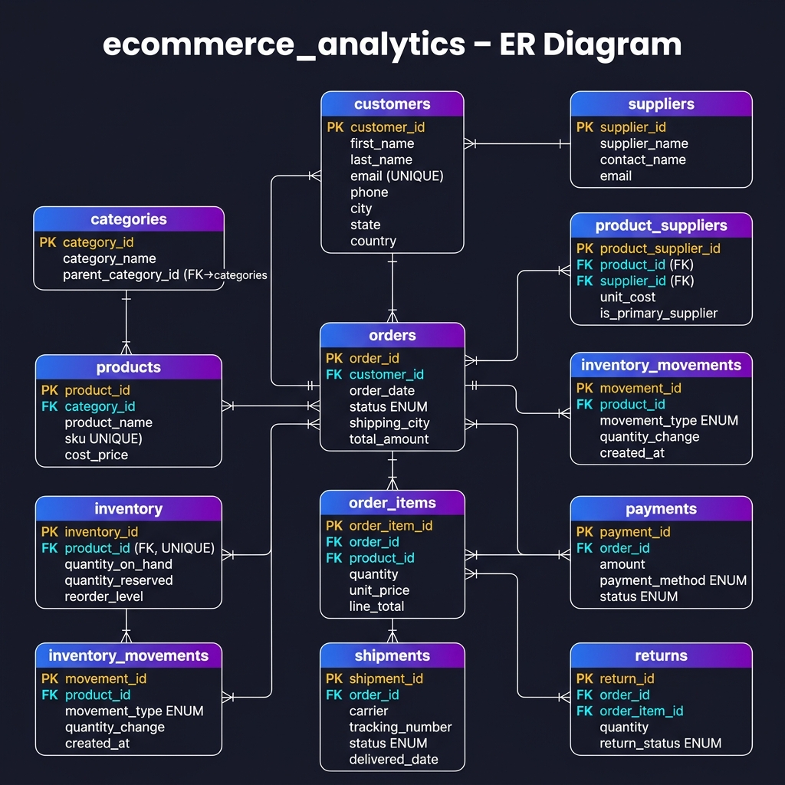

# E-Commerce Sales & Inventory Management System

A complete, production-quality MySQL 8.0+ database project demonstrating intermediate-to-advanced SQL skills for SQL Developer, Database Developer, and Data Analyst roles.

---

## Project Overview

This project models a realistic single-warehouse Indian e-commerce platform from the ground up — covering the full order lifecycle: product cataloguing, supplier management, inventory tracking, order placement with transaction safety, payment processing, shipping, and returns.

**Key highlights:**
- 12 normalised tables with full referential integrity
- Transactional order placement with deadlock-safe inventory locking
- 33 business intelligence queries using CTEs, window functions, and RFM analysis
- 5 views, 5 stored procedures, 5 functions, and 5 triggers
- 45-test automated test suite
- Complete documentation and interview preparation guide

---

## Features

| Feature | Detail |
|---------|--------|
| Database | MySQL 8.0+, InnoDB, utf8mb4 |
| Tables | 12 (customers, products, categories, suppliers, product_suppliers, inventory, inventory_movements, orders, order_items, payments, shipments, returns) |
| Sample Data | 100 customers, 50 products, 10 suppliers, 1000+ orders, multi-month data |
| Analytics | 33 numbered business queries |
| Views | 5 reporting views |
| Procedures | 5 (order history, sales report, place order, adjust inventory, process return) |
| Functions | 5 (line total, margin %, tax, delivery days, customer segment) |
| Triggers | 5 (line total validation, status changes, inventory guard, return audit, price audit) |
| Tests | 45 automated test cases across 6 groups |
| Indexes | 18 strategic indexes with justification |

---

## Database Architecture

```
customers ──< orders ──< order_items >── products >── categories
                 │              │
                 │          (via product_id)
                 │
           payments     inventory ←── inventory_movements
           shipments
           returns ←── order_items

suppliers ──< product_suppliers >── products
```

The schema is normalised to approximately **Third Normal Form (3NF)**.

---

## ER Diagram



---

## Project Structure

```
ecommerce-mysql-project/
├── README.md
├── .gitignore
├── sql/
│   ├── 01_create_database.sql       — Create ecommerce_analytics DB
│   ├── 02_create_tables.sql         — All 12 tables with constraints
│   ├── 03_indexes.sql               — 18 strategic indexes
│   ├── 04_seed_data.sql             — 100 customers, 50 products, 1000+ orders
│   ├── 05_views.sql                 — 5 reporting views
│   ├── 06_stored_procedures.sql     — 5 business procedures
│   ├── 07_functions.sql             — 5 deterministic functions
│   ├── 08_triggers.sql              — 5 automation triggers
│   ├── 09_analytics_queries.sql     — 33 business intelligence queries
│   ├── 10_test_cases.sql            — 45 automated tests
│   └── 11_performance_testing.sql   — EXPLAIN plans & index demos
└── docs/
    ├── ER_Diagram.png               — Visual entity-relationship diagram
    ├── database_design.md           — Schema decisions and relationships
    ├── business_rules.md            — All enforced business rules
    ├── interview_questions.md       — 25 Q&A for job interviews
    └── sample_results.md            — Expected query output
```

---

## Requirements

- **MySQL 8.0.18 or later** (8.0.18+ required for `EXPLAIN ANALYZE`)
- **MySQL Workbench 8.0** (recommended client) or any MySQL CLI
- No Python, Java, Node.js, or other language required — pure SQL

---

## Installation & Setup

### 1. Install MySQL 8.0+

**macOS (Homebrew):**
```bash
brew install mysql
brew services start mysql
mysql_secure_installation
```

**Windows:**  
Download the MySQL Installer from https://dev.mysql.com/downloads/installer/

**Ubuntu/Debian:**
```bash
sudo apt update
sudo apt install mysql-server-8.0
sudo systemctl start mysql
```

---

### 2. Open MySQL Workbench

1. Launch **MySQL Workbench**
2. Create a new connection: `localhost`, port `3306`, username `root`
3. Open a new SQL tab (Ctrl+T)

---

### 3. Run Scripts in Order

Execute each script in the following order. **Do not skip steps.**

```sql
SOURCE /path/to/sql/01_create_database.sql;
SOURCE /path/to/sql/02_create_tables.sql;
SOURCE /path/to/sql/03_indexes.sql;
SOURCE /path/to/sql/04_seed_data.sql;
SOURCE /path/to/sql/05_views.sql;
SOURCE /path/to/sql/06_stored_procedures.sql;
SOURCE /path/to/sql/07_functions.sql;
SOURCE /path/to/sql/08_triggers.sql;
```

Or run from the command line:
```bash
mysql -u root -p < sql/01_create_database.sql
mysql -u root -p ecommerce_analytics < sql/02_create_tables.sql
mysql -u root -p ecommerce_analytics < sql/03_indexes.sql
mysql -u root -p ecommerce_analytics < sql/04_seed_data.sql
mysql -u root -p ecommerce_analytics < sql/05_views.sql
mysql -u root -p ecommerce_analytics < sql/06_stored_procedures.sql
mysql -u root -p ecommerce_analytics < sql/07_functions.sql
mysql -u root -p ecommerce_analytics < sql/08_triggers.sql
```

---

### 4. Run Analytics Queries

Open `sql/09_analytics_queries.sql` in MySQL Workbench.  
Run individual queries (Ctrl+Enter on a selected query) or all at once.

---

### 5. Run the Test Suite

```sql
SOURCE /path/to/sql/10_test_cases.sql;
```

Expected output: 45+ lines starting with `PASS:`.  
Any `FAIL:` output indicates a test that did not meet its assertion.

---

### 6. Explore Performance Testing

```sql
SOURCE /path/to/sql/11_performance_testing.sql;
```

Review EXPLAIN output in the **Result Grid** in MySQL Workbench.

---

## Sample Queries

### Top 5 Products by Revenue
```sql
SELECT p.product_name, c.category_name,
       SUM(oi.quantity) AS units_sold,
       ROUND(SUM(oi.line_total), 2) AS revenue
FROM order_items oi
JOIN products p   ON p.product_id   = oi.product_id
JOIN categories c ON c.category_id  = p.category_id
JOIN orders o     ON o.order_id     = oi.order_id
WHERE o.status NOT IN ('CANCELLED')
GROUP BY p.product_id, p.product_name, c.category_name
ORDER BY revenue DESC
LIMIT 5;
```

### Month-over-Month Growth
```sql
WITH monthly AS (
    SELECT DATE_FORMAT(o.order_date, '%Y-%m') AS month,
           ROUND(SUM(oi.line_total), 2) AS revenue
    FROM orders o JOIN order_items oi ON oi.order_id = o.order_id
    WHERE o.status NOT IN ('CANCELLED')
    GROUP BY month
)
SELECT month, revenue,
       ROUND((revenue - LAG(revenue) OVER (ORDER BY month))
             / NULLIF(LAG(revenue) OVER (ORDER BY month), 0) * 100, 2) AS mom_growth_pct
FROM monthly ORDER BY month;
```

### Low-Stock Alert
```sql
SELECT p.product_name, i.quantity_on_hand, i.reorder_level,
       CASE WHEN i.quantity_on_hand = 0 THEN 'OUT_OF_STOCK'
            WHEN i.quantity_on_hand <= i.reorder_level THEN 'LOW_STOCK'
            ELSE 'OK' END AS alert
FROM inventory i JOIN products p ON p.product_id = i.product_id
WHERE i.quantity_on_hand <= i.reorder_level;
```

---

## Testing

The test suite in `10_test_cases.sql` covers:

| Group | Tests | What is Tested |
|-------|-------|----------------|
| Schema Structure | T01–T06 | Table count, views, InnoDB engine, FK existence |
| Data Integrity | T07–T12 | Duplicate email, negative values, invalid FKs |
| Function Correctness | T13–T20 | All 5 functions with boundary conditions |
| Seed Data Counts | T21–T30 | Row counts, FK integrity, orphan detection |
| Business Logic | T31–T38 | Return limits, payment rules, inventory consistency |
| Analytics Smoke | T41–T45 | Query row counts, revenue reconciliation |

**To reset and re-run:**
```sql
SOURCE sql/01_create_database.sql;  -- drops and recreates
-- then run 02-08 again, then 10
```

---

## Query Optimisation Approach

1. **Index every FK column** — prevents full table scans on JOIN operations.
2. **Composite indexes match query patterns** — `(status, order_date)` supports the most common dashboard filter.
3. **Leftmost prefix rule** — high-cardinality or equality columns placed first.
4. **Covering indexes** — `(customer_id, status)` allows index-only scans for order summaries.
5. **Avoid functions on indexed columns** — use range predicates instead.
6. **EXPLAIN ANALYZE** — used in `11_performance_testing.sql` to verify index usage.

---

## Known Limitations

1. **Single warehouse** — extend with a `warehouses` table for multi-location stock.
2. **No product variants** — size/colour variants not modelled; add a `product_variants` table.
3. **One return per order line** — partial batch returns not supported.
4. **Flat GST** — uses a 9% estimate; real implementation needs CGST/SGST/IGST by state.
5. **No coupon system** — discounts applied as flat line-item percentages only.

---

## Future Improvements

- [ ] Add multi-warehouse inventory management
- [ ] Product variants (size, colour, weight)
- [ ] Coupon and promotion engine
- [ ] Customer loyalty points system
- [ ] GST compliance (CGST/SGST/IGST breakdowns)
- [ ] Partitioning on `orders` and `inventory_movements` for scale
- [ ] Event Scheduler for daily summary table refresh
- [ ] Read replica routing for analytics queries

---

## Skills Demonstrated

| Category | Skills |
|----------|--------|
| **Schema Design** | 3NF normalisation, FK constraints, CHECK constraints, UNIQUE constraints |
| **SQL Querying** | INNER JOIN, LEFT JOIN, GROUP BY, HAVING, subqueries |
| **Advanced SQL** | CTEs, window functions (RANK, DENSE_RANK, ROW_NUMBER, LAG, NTILE, PERCENT_RANK) |
| **Analytics** | RFM segmentation, market basket analysis, MoM growth, rolling averages |
| **Transactions** | ACID compliance, SELECT FOR UPDATE, deadlock prevention, error handlers |
| **Stored Objects** | Procedures, functions, triggers, views |
| **Performance** | EXPLAIN, EXPLAIN ANALYZE, composite indexes, covering indexes |
| **Testing** | Assertion-based test procedures, boundary condition testing |
| **Documentation** | ER diagram, design decisions, business rules, interview Q&A |

---

## How to Publish on GitHub

```bash
cd "/path/to/ecommerce sales and inventory management"
git init
git add .
git commit -m "Initial commit: E-Commerce MySQL project"
# Create a new repo on GitHub (ecommerce-mysql-project)
git remote add origin https://github.com/YOUR_USERNAME/ecommerce-mysql-project.git
git branch -M main
git push -u origin main
```

**Recommended GitHub repo description:**
> Production-quality MySQL 8.0 database for an e-commerce platform. Features 12 tables, 1000+ seed records, 33 business intelligence queries, window functions, CTEs, stored procedures, triggers, and a 45-test automated test suite.

---

## Files to Highlight in an Interview

| File | Why Show It |
|------|-------------|
| `sql/02_create_tables.sql` | Schema design, constraints, relationships |
| `sql/06_stored_procedures.sql` | `sp_place_order` — transactional safety, locking |
| `sql/09_analytics_queries.sql` | Window functions, CTEs, RFM, market basket |
| `sql/11_performance_testing.sql` | EXPLAIN plans, index strategy |
| `docs/ER_Diagram.png` | Visual architecture overview |
| `docs/interview_questions.md` | Depth of understanding |

---

## Author

Built as a portfolio project demonstrating professional MySQL database engineering skills.  
All data is synthetic and for demonstration purposes only. No real customer data is used.
